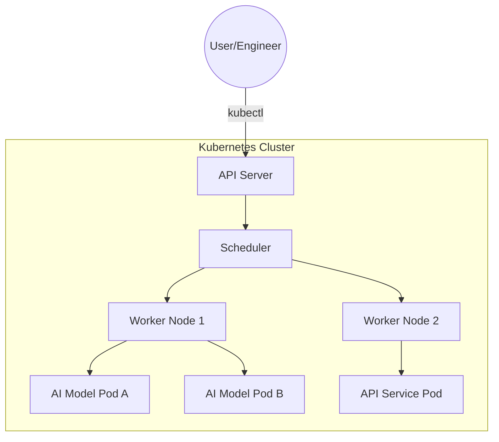
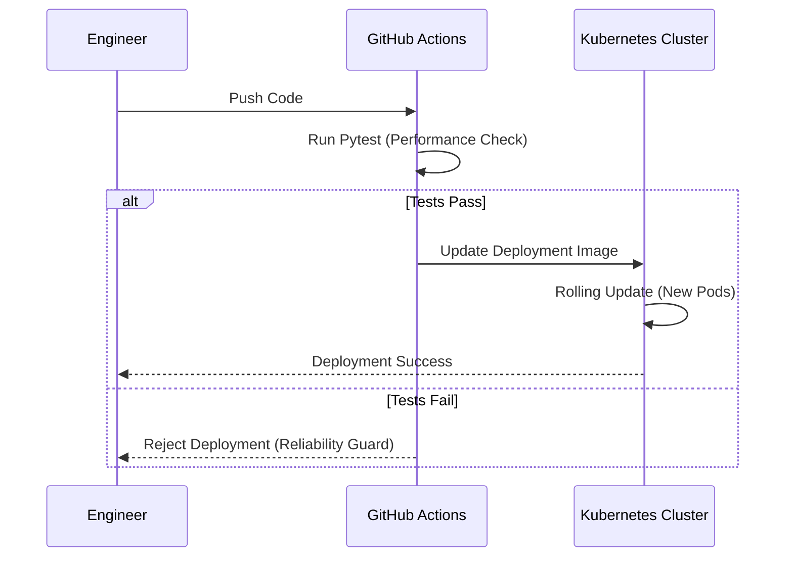

# CONTAINER DEPLOYMENT WITH KUBERNETES

**Session Time:** 120 minutes

---

## Table of Contents

1. Introduction to AI Orchestration
2. Benefits of Containerization for AI
3. Deploying and Managing Kubernetes Clusters
4. Analyzing Performance and Scalability
5. Lab: Testing Workflow Setup
6. Wrap-Up and Reflection
7. Resources

---

## Learning Objectives

By the end of this module, participants will be able to:

1. **Explain** the benefits of containerization for AI applications, focusing on reproducibility and dependency management.
2. **Deploy and manage** containers using Kubernetes clusters to ensure high availability of AI services.
3. **Analyze** deployment performance and scalability within a containerized environment to optimize resource allocation.

---

## Session Breakdown

| Segment | Topic                                   | Duration (minutes) |
|---------|-----------------------------------------|--------------------|
| 1       | The Case for Containers in AI           | 15                 |
| 2       | Kubernetes Architecture & Orchestration | 25                 |
| 3       | Scalability and Resource Optimization   | 20                 |
| 4       | Lab: Testing Workflow Setup             | 60                 |

---

## 1. Benefits of Containerization for AI

For professionals, the primary challenge in AI systems is "Environment Drift"—where a model performs differently in production than in development due to library versions (e.g., NumPy or PyTorch) or OS dependencies.

### Why Containerize AI?

* **Dependency Isolation:** Package specific CUDA versions or Python binaries without conflicting with the host system.
* **Portability:** Move a model from a local laptop to a massive GPU cloud provider without code changes.
* **Reproducibility:** Ensure that a model's inference results remain consistent across different lifecycle stages.

### Tool: Pytest (Validation)

Before a container is even built, **Pytest** is used to ensure the AI logic is sound.

**Practical Example:**
Using Pytest to check if an image classification model returns the correct shape before it is packaged into a Docker image.

```python
# test_model.py
import pytest
from model_loader import load_model

def test_inference_shape():
    model = load_model()
    dummy_input = ... 
    prediction = model.predict(dummy_input)
    assert prediction.shape == (1, 10), "Model output shape mismatch!"

```

---

## 2. Deploying and Managing Kubernetes Clusters

Kubernetes (K8s) acts as the "Operating System" for your data center, managing where and how your AI containers run.

### Tool: Kubernetes & Minikube

* **Minikube:** A local Kubernetes tool that allows professionals to simulate a production cluster on a single machine.
* **Kubernetes:** The production-grade orchestrator that manages Pods (the smallest deployable units containing your containers).

### Architecture Diagram



**Practical Example:**
Deploying an AI inference service using a `deployment.yaml` file to ensure 3 replicas of the model are always running.

```yaml
apiVersion: apps/v1
kind: Deployment
metadata:
  name: ai-inference-service
spec:
  replicas: 3
  selector:
    matchLabels:
      app: ai-model
  template:
    metadata:
      labels:
        app: ai-model
    spec:
      containers:
      - name: model-container
        image: my-registry/ai-model:v1.2
        ports:
        - containerPort: 8080

```

---

## 3. Analyzing Performance and Scalability

In AI Systems Engineering, performance is measured by throughput (requests per second) and latency, while scalability is the system's ability to handle increased load by adding resources.

### Tool: GitHub Actions (Continuous Deployment)

Automation ensures that performance checks are integrated into the deployment lifecycle.

**Practical Example:**
A GitHub Action that triggers a deployment to a Kubernetes cluster only after the `Pytest` suite confirms the model meets latency requirements.



### Technical Detail: Resource Requests and Limits

To optimize performance, engineers must define **Resources**:

* **Requests:** The minimum CPU/RAM the AI container is guaranteed.
* **Limits:** The maximum CPU/RAM the container can consume. This prevents a "runaway" inference process from crashing the entire cluster.

---

## 4. Lab: Testing Workflow Setup

**Objective:** Integrate automated tests into a deployment pipeline using PyTest and GitHub Actions. This lab ensures learners can verify AI model and API performance consistently.

[Reference: Lab content]

---

## 5. Wrap-Up and Reflection

**Reflection Questions:**

1. Why is a rolling update in Kubernetes safer for a high-traffic AI model than a manual "delete and replace" approach?
2. How do resource limits in Kubernetes impact the cost-efficiency of an AI project?
3. How does Pytest serve as the first line of defense in an automated CI/CD pipeline?

---

## 6. Resources

* **Kubernetes Basics:** [Official Kubernetes Documentation](https://kubernetes.io/docs/home/)
* **Local K8s Testing:** [Minikube Start Guide](https://minikube.sigs.k8s.io/docs/start/)
* **Testing for ML:** [Pytest Documentation](https://docs.pytest.org/en/stable/)
* **CI/CD Orchestration:** [GitHub Actions for Azure/AWS Kubernetes](https://github.com/features/actions)
* **Container Security:** [Best Practices for Dockerizing AI Models](https://www.google.com/search?q=https://www.docker.com/blog/how-to-dockerize-your-machine-learning-workflows/)