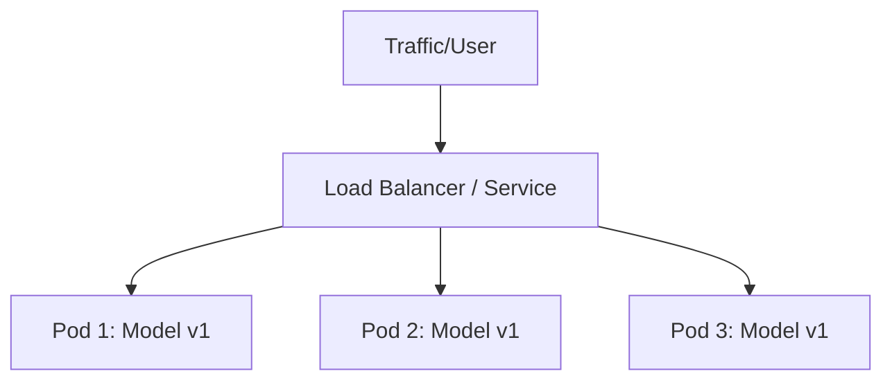

# Instructor Guide: Container Deployment with Kubernetes

## Module Overview

This module transitions mid-career professionals from local container development to production-grade orchestration. Students will learn how Kubernetes (K8s) solves the challenges of running AI models at scale, focusing on high availability, resource optimization, and automated health checks. The session bridges the gap between a single Docker container and a distributed system capable of handling variable inference loads.

## Learning Objectives

By the end of this session, students will be able to:

* **Explain** the benefits of containerization for AI applications, focusing on reproducibility and dependency management.
* **Deploy and manage** containers using Kubernetes clusters to ensure high availability of AI services.
* **Analyze** deployment performance and scalability within a containerized environment.

## Session Pacing Guide (120 Minutes total)

| Duration   | Segment                         | Instructor Action                                                                                                                       |
|------------|---------------------------------|-----------------------------------------------------------------------------------------------------------------------------------------|
| **20 min** | **The Case for K8s in AI**      | Contrast "Docker Run" vs "Kubernetes Orchestration." Discuss the "Single Point of Failure" risk in AI inference.                        |
| **40 min** | **Kubernetes Objects & YAML**   | Live demo: Explain Pods, Deployments, and Services. Deploy a model to Minikube. Show how K8s restarts a crashed container.              |
| **60 min** | **Lab: Testing Workflow Setup** | Facilitate the lab. Focus on the integration between GitHub Actions and the cluster. Ensure students understand the "Reliability Gate." |

---

## Delivery Notes & Teaching Tips

### 1. Scaling the "Black Box"

* **The Orchestrator Analogy:** Compare Kubernetes to a conductor of an orchestra. Each musician (container) knows their part, but the conductor ensures they start together, stay in sync, and replaces a musician if they fall ill.
* **AI Resource Intensity:** Emphasize that AI models are resource-heavy. Kubernetes' ability to set "Resource Limits" is a reliability feature—it prevents one model from consuming all the node's memory and crashing neighboring services.

### 2. Visualizing Orchestration

---

## Common Student Issues & Solutions

| Issue                            | Potential Cause                                                                   | Solution                                                                                                   |
|----------------------------------|-----------------------------------------------------------------------------------|------------------------------------------------------------------------------------------------------------|
| **`ImagePullBackOff` Error**     | The K8s cluster cannot find the Docker image (wrong name or private registry).    | Check image tag with `kubectl describe pod`. Ensure the image was pushed to the registry before deploying. |
| **`CrashLoopBackOff`**           | The AI model is failing internally (e.g., missing weights file or OOM).           | Check logs using `kubectl logs [pod-name]`. Often, the model needs more memory than the "Limit" allows.    |
| **Minikube not starting**        | Virtualization (VT-x/AMD-v) is disabled in BIOS or conflicts with Docker Desktop. | Use `minikube start --driver=docker` to run Minikube inside a Docker container instead of a VM.            |
| **Tests pass, but Deploy fails** | GitHub Actions environment variables (secrets) are missing for K8s access.        | Verify that the `KUBECONFIG` or Service Account tokens are correctly added to GitHub Repository Secrets.   |
| **Service not reachable**        | Deployment is running, but the "Service" object has the wrong selector.           | Verify that `spec.selector` in the Service YAML matches the `labels` in the Deployment YAML.               |

---

## Debrief Questions

1. "In an AI context, why might we prefer a 'Small' model replica count of 5 over one 'Huge' model pod?" (Answer: Redundancy and better bin-packing on nodes).
2. "How does a 'Readiness Probe' in Kubernetes prevent a user from hitting a model that is still loading 5GB of weights into memory?"
3. "What happens to the reliability of your system if your CI pipeline bypasses Pytest and goes straight to Kubernetes deployment?"

---

## Resources for the Instructor

* **Reference:** 
  * [Kubernetes Official Interactive Tutorials](https://kubernetes.io/docs/tutorials/)
  * [Minikube Documentation](https://minikube.sigs.k8s.io/docs/)
* **AI Prompt Bank:**
  * *"Write a Kubernetes Deployment YAML for a Python API with 3 replicas and a memory limit of 2Gi."*
  * *"Explain the difference between a ClusterIP and a LoadBalancer service in Kubernetes."*